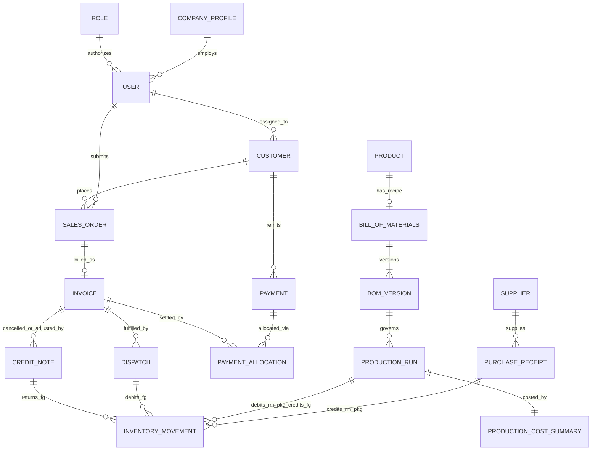
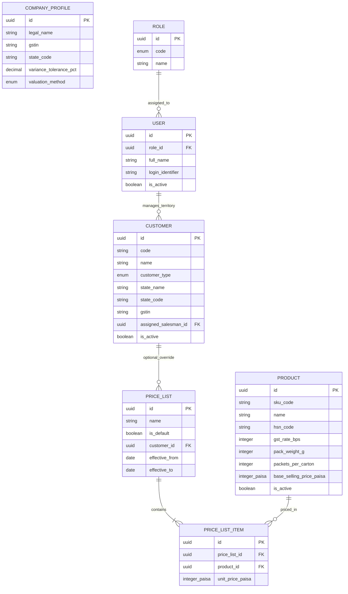
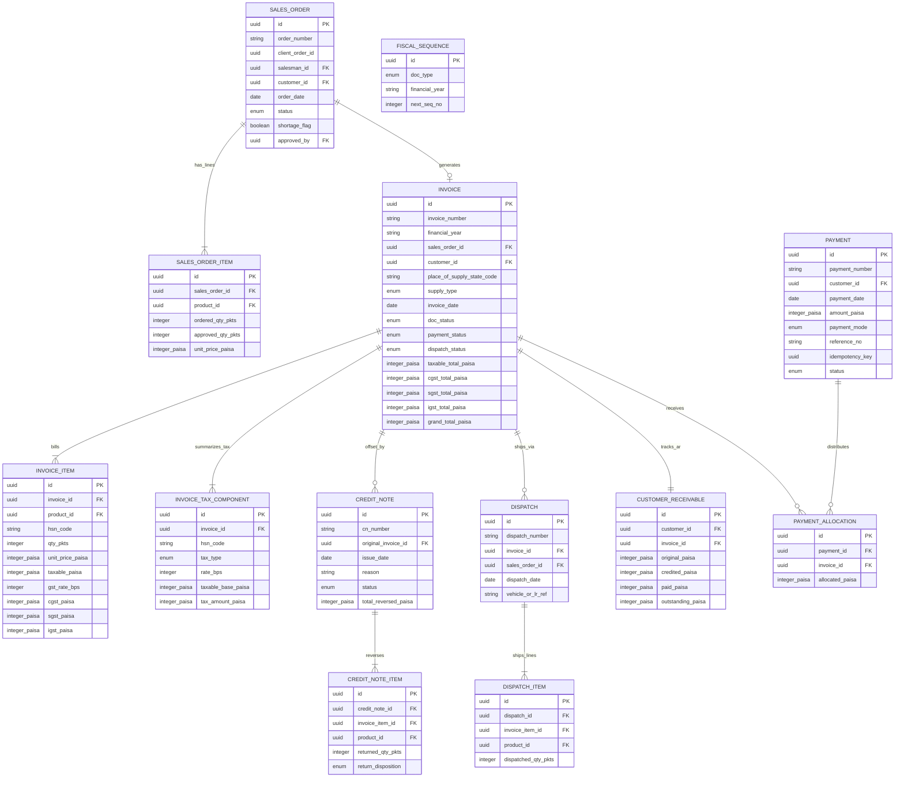
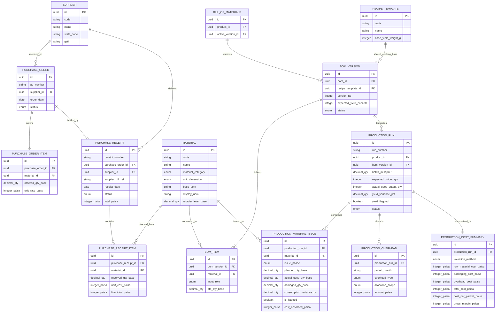
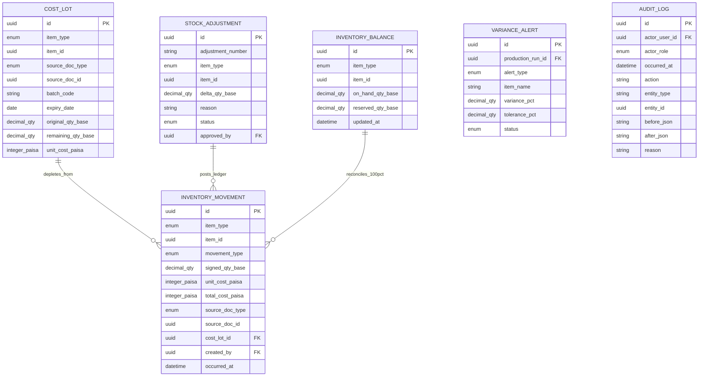

# Conceptual Entity-Relationship Diagrams

**Diagram Strategy:** To avoid an unreadable spaghetti diagram across ~35 domain entities, this document presents:
1. **Diagram 1:** High-Level Cross-Module Conceptual Architecture ER Diagram (Core Aggregates & Bridge Keys).
2. **Diagram 2:** IAM & Commercial Masters (`Users`, `Customers`, `Products`, `PriceLists`).
3. **Diagram 3:** Sales Loop (`SalesOrder` -> `Invoice` / `CreditNote` -> `Dispatch` -> `Payment` / `Receivable`).
4. **Diagram 4:** Production Loop (`Suppliers`, `PurchaseReceipt`, `RecipeTemplate`, `BOM`, `ProductionRun`, `Costing`).
5. **Diagram 5:** Inventory Ledger, Cost Lots & Audit Trail (`InventoryBalance`, `InventoryMovement`, `CostLot`, `AuditLog`).

> *Note:* Attribute types (`uuid`, `string`, `integer_paisa`, `decimal_qty`, `enum`, `date`, `datetime`, `boolean`) represent **conceptual domain types**, not physical SQL DDL types.

---

## 1. High-Level Cross-Module ER Overview (Core Aggregates)

---

## 2. Module Diagram A — IAM & Commercial Masters

---

## 3. Module Diagram B — Sales Orders, GST Billing, Dispatch & Payments

---

## 4. Module Diagram C — Purchasing, BOM, Production & Costing

---

## 5. Module Diagram D — Inventory Ledger, Cost Lots, Variance Alerts & Audit

