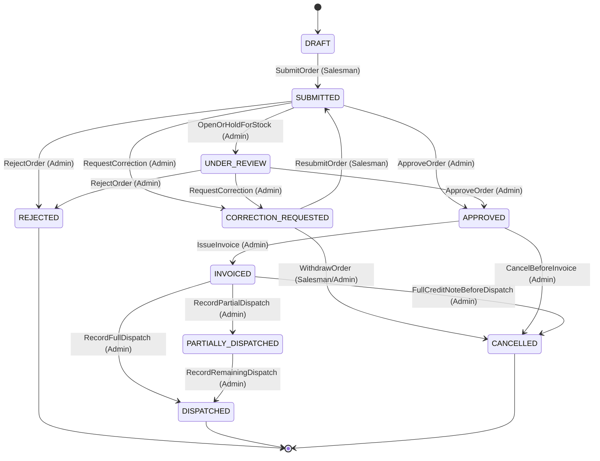
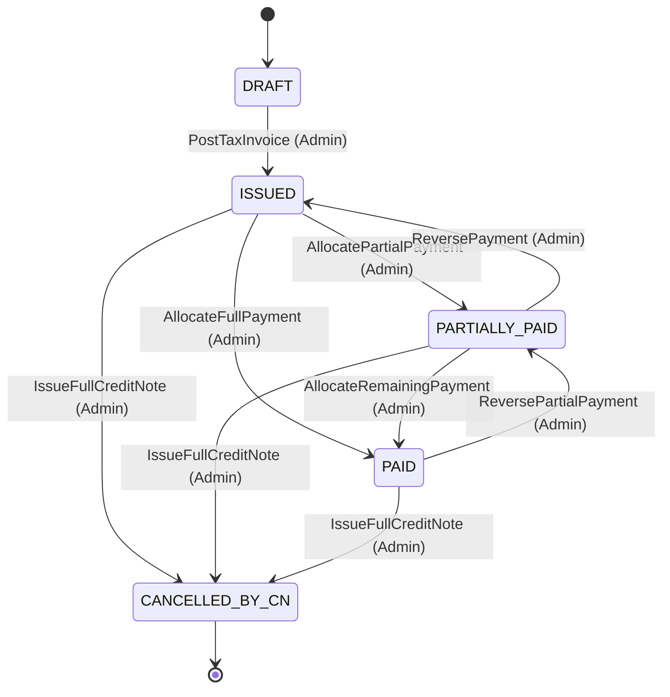
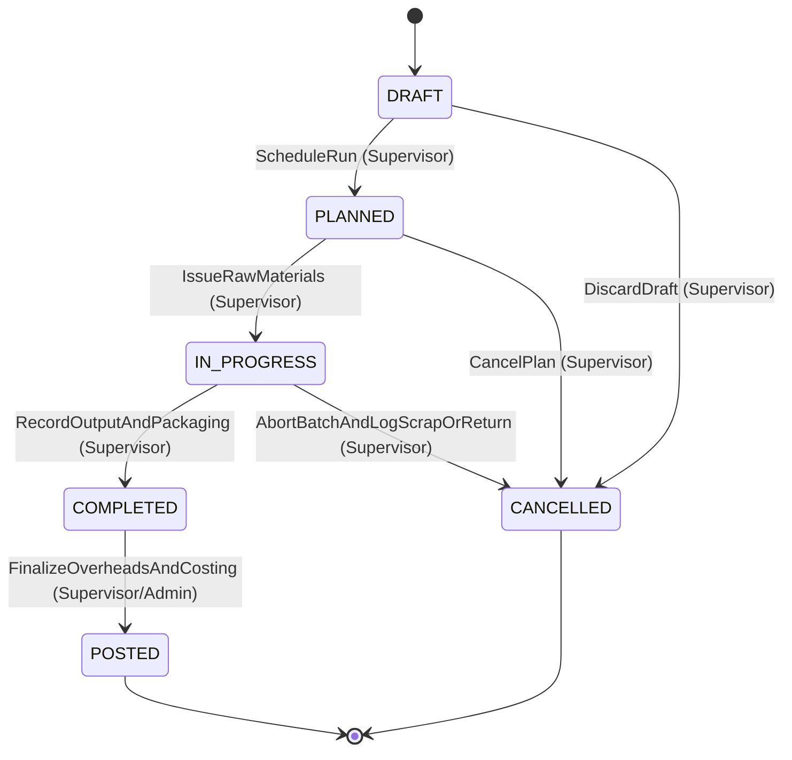
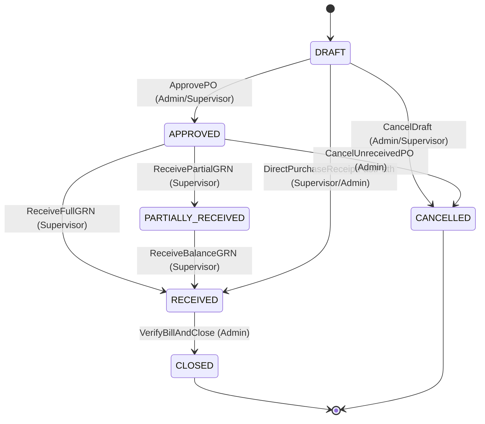
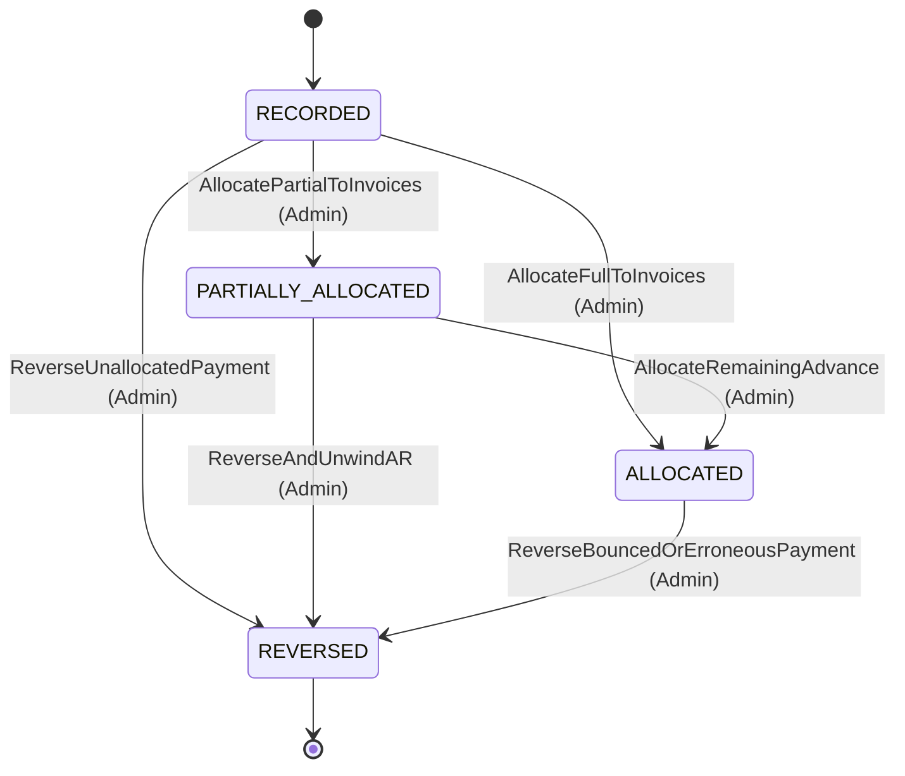

# Domain Lifecycle State Machines

Every aggregate lifecycle documents valid transitions, invalid/blocked transitions, triggering actions, responsible roles, guards, and resulting side effects.  
**Rule 3 Compliance:** Where Task 5 example state lists differ slightly from Phase 1 approved rules or Benchmark step ordering, the difference is explicitly reconciled rather than silently altered.

---

## 1. State Machine A: `SalesOrder`

### Reconciliation with Phase 1
- **Task 5 Example:** `Draft → Submitted → Under Review → Approved / Rejected → Invoiced → Partially Dispatched / Dispatched`
- **Phase 1 Approved Baseline (`BR-ORD-01`):** Includes `CORRECTION_REQUESTED` (so Admin can return an order to the Salesman without rejecting it) and `CANCELLED`.
- **Reconciled Model:** Preserves **all** Task 5 states **plus** `CORRECTION_REQUESTED` and `CANCELLED`. Note that `UNDER_REVIEW` can be entered explicitly when Admin opens/holds an order (e.g., Distributor B `SHORTAGE` hold) or bridged automatically on Admin pickup.

| From State | To State | Trigger & Role | Guards | Side Effects |
| --- | --- | --- | --- | --- |
| `DRAFT` | `SUBMITTED` | `SubmitOrder` (Salesman) | `lines >= 1`, `qty > 0`, active Customer, unique `client_order_id` | Persists order + frozen price snapshot; no stock deducted. |
| `SUBMITTED` / `UNDER_REVIEW` | `CORRECTION_REQUESTED` | `RequestCorrection` (Admin) | Mandatory correction comment | Unlocks order for owning Salesman to edit & resubmit. |
| `CORRECTION_REQUESTED` | `SUBMITTED` | `ResubmitOrder` (Salesman) | Valid lines | Re-enters Admin pending queue; audit logged. |
| `SUBMITTED` / `UNDER_REVIEW` | `APPROVED` | `ApproveOrder` (Admin) | `Available FG Stock >= Approved Qty` across all lines (row-locked) | Soft-reserves FG stock (`Reserved += approved_qty`); locks Salesman edits; writes `AuditLog`. |
| `SUBMITTED` / `UNDER_REVIEW` | `REJECTED` | `RejectOrder` (Admin) | Mandatory rejection reason | Terminal; notifies Salesman view. |
| `APPROVED` | `INVOICED` | `IssueInvoice` (Admin) | Not previously invoiced | Creates `ISSUED` GST `Invoice` + `CustomerReceivable`; keeps FG reservation until dispatch. |
| `APPROVED` | `CANCELLED` | `CancelOrder` (Admin) | Not yet invoiced; reason required | Releases FG soft reservation; writes `AuditLog`. |
| `INVOICED` | `PARTIALLY_DISPATCHED` / `DISPATCHED` | `RecordDispatch` (Admin) | `0 < dispatch_qty <= remaining_undispatched <= OnHand` | Writes `DISPATCH_OUT` to `InventoryMovement`; releases corresponding `Reserved` qty. |
| `INVOICED` | `CANCELLED` | `FullCreditNote` (Admin) | No unreturned dispatch | Linked `CreditNote` issued; releases `Reserved` qty. |

**Explicitly Blocked Invalid Transitions:**
- `DRAFT / SUBMITTED -> INVOICED` (must pass `APPROVED` stock check first).
- `SALESMAN` cannot trigger `APPROVED`, `REJECTED`, `INVOICED`, or `DISPATCHED`.
- `APPROVED` when `Available < Ordered` (e.g., Distributor B `120` vs `88`) -> blocked; order stays `SUBMITTED` / `UNDER_REVIEW` (`shortage_flag = true`).
- `DISPATCHED -> SUBMITTED / APPROVED` (terminal state).

---

## 2. State Machine B: `Invoice` (+ Credit Note)

### Reconciliation with Task 5 & Phase 1
- Task 5 lists linear states: `Draft → Issued → Partially Paid / Paid → Cancelled through Credit Note`.
- Phase 1 uses `POSTED` (`UNPAID` / `PARTIALLY_PAID` / `PAID`) -> `CANCELLED_BY_CN`.
- **Harmonized Design:** Use `ISSUED` (equivalent to Phase 1 `POSTED`) as the statutory lock point where FY sequence (`INV/2026-27/0001`) and `CustomerReceivable` are finalized. Track payment settlement (`UNPAID | PARTIALLY_PAID | PAID | CREDITED`) cleanly alongside document status so partial payments never hide whether an invoice is still `ISSUED` vs `CANCELLED_BY_CN`!

- **Key Side Effects & Guards:**
  - `DRAFT -> ISSUED`: Acquires `FiscalSequence` for Indian FY, writes `InvoiceTaxComponent`s (`CGST+SGST` or `IGST`), creates `CustomerReceivable`.
  - `ISSUED / PARTIALLY_PAID / PAID -> CANCELLED_BY_CN`: Requires creating an immutable `CreditNote` (`CN/2026-27/XXXX`) with reason. Reverses AR & GST liability; if already paid in part (`PARTIALLY_PAID`/`PAID`), creates an `UNALLOCATED_CREDIT` balance for the customer; if already dispatched, triggers `SalesReturn` stock handling (`CREDIT_RETURN_IN` if sellable, or scrap log).
  - **Forbidden:** Deleting any `ISSUED` invoice; mutating taxable amount, GST split, or invoice number after `ISSUED`.

---

## 3. State Machine C: `ProductionRun`

### Critical Conflict Reconciliation (Task 5 vs Benchmark Step 2 -> 3 -> 5 -> 8)
- **Task 5 Example:** `Draft → Planned → In Progress → Completed → Posted.`
- **Benchmark Sequencing Reality:**
  - **Step 2:** Supervisor starts run and issues `40 kg` flour, `10.5 L` oil, `1.2 kg` spice -> Raw stock must decrease (`160->120`, `30->19.5`, `5->3.8`) at `IN_PROGRESS`.
  - **Step 3:** Supervisor records `188` good packets, `6` damaged pouches, `9` cartons -> Finished stock increases (`50->238`) and packaging decreases (`500->306`, `30->21`) so **Step 5** can already dispatch `150` of those packets!
  - **Step 8:** Labour (`₹1,200`) and Gas/Power (`₹600`) are added **later** to finalize `Cost per Packet`.
- **Conflict Identified:** If stock only posted at the final `POSTED` step *after* Step 8 overheads, Step 5 could not sell the `188` packets made in Step 3!
- **Reconciled State Machine:** Preserve all Task 5 states while clearly mapping **when** stock posts vs when financial costing closes:
  - `DRAFT -> PLANNED`: Target SKU, `BomVersion`, and `batch_multiplier` chosen (no stock effect yet).
  - `PLANNED -> IN_PROGRESS`: **Step 2** — Raw materials issued (`PROD_ISSUE_OUT` posted to `InventoryMovement` immediately + FIFO lots consumed).
  - `IN_PROGRESS -> COMPLETED`: **Step 3** — Good packets (`PROD_OUTPUT_IN`), damaged & good packaging (`PROD_ISSUE_OUT` / `PACKAGING_DAMAGE_OUT`), and yield/consumption variances posted immediately to Stock Ledger so FG stock (`238`) is sellable! Preliminary material+packaging cost calculated.
  - `COMPLETED -> POSTED`: **Step 8** — Direct overheads (`Labour`, `Gas/Power`) finalized and locked into `ProductionCostSummary` (`₹5,810 / 188 = ₹30.90`). *(Alternatively, if overheads are known at completion, `COMPLETED -> POSTED` happens in one click!)*
  - `PLANNED / IN_PROGRESS -> CANCELLED` (`EC-06`): Aborted batch; unspoiled raw materials return via `PROD_RETURN_IN`, spoiled inputs recorded as logged scrap.

- **Blocked Transitions:** `IN_PROGRESS -> COMPLETED` blocked if packaging stock `< good + damaged` used; `POSTED` runs cannot be silently edited or deleted (`EC-16`: requires logged adjustment/reopening audit entry).

---

## 4. State Machine D: `Purchase` (`PurchaseOrder` & `PurchaseReceipt`)

### Reconciliation with Phase 1
- **Task 5 Example:** `Draft → Approved → Received → Closed.`
- **Phase 1 Benchmark (`Step 1`):** Floor supervisor records direct receipt of `60 kg` flour @ `₹45/kg` immediately without a formal PO prerequisite.
- **Reconciled Design:**
  - `PurchaseOrder` follows Task 5: `DRAFT → APPROVED → RECEIVED (or PARTIALLY_RECEIVED) → CLOSED` (plus `CANCELLED` pre-receipt).
  - `PurchaseReceipt` supports both PO-linked receipts and direct counter-purchase fast-path (`DRAFT → RECEIVED → CLOSED`), where `RECEIVED` atomically posts `PURCHASE_IN` to `InventoryMovement` and creates a `CostLot`.

---

## 5. State Machine E: `Payment`

- **Task 5 Example:** `Recorded → Allocated → Reversed`
- **Reconciled Model:** Supports both **single-step invoice payment** (`RECORDED -> ALLOCATED` atomically, as in Benchmark Step 7 `PMT-001` `₹4,000` on Retailer A's invoice) AND **advance / multi-invoice payment** (`RECORDED -> PARTIALLY_ALLOCATED -> ALLOCATED`), plus `REVERSED` for bounced cheques or erroneous entries (creating compensating AR adjustment, never hard deletion).

