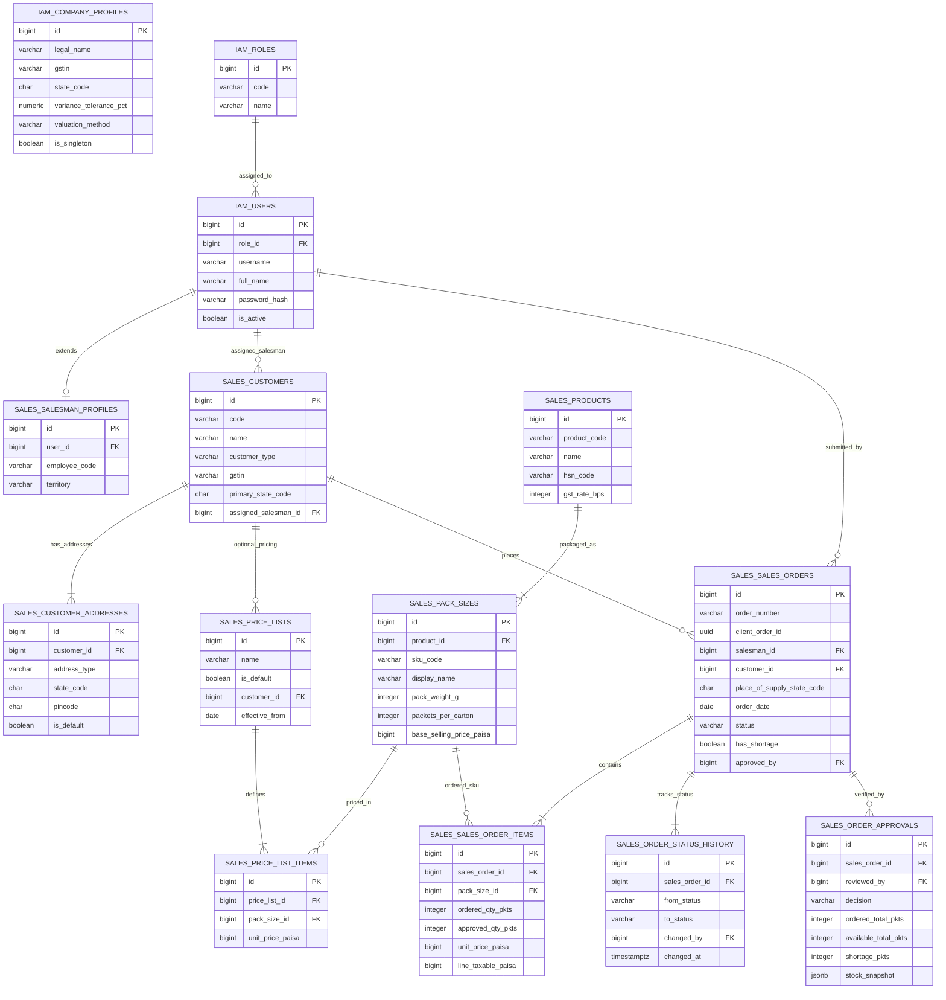
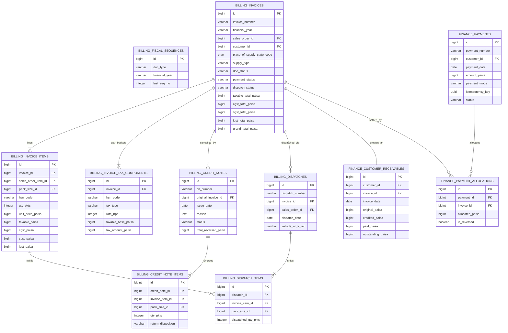
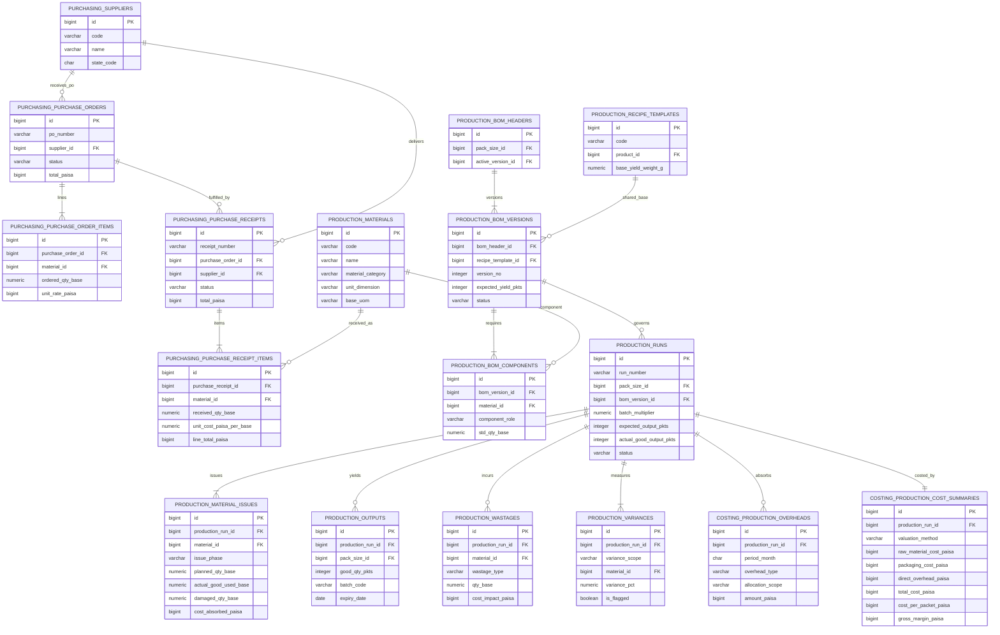
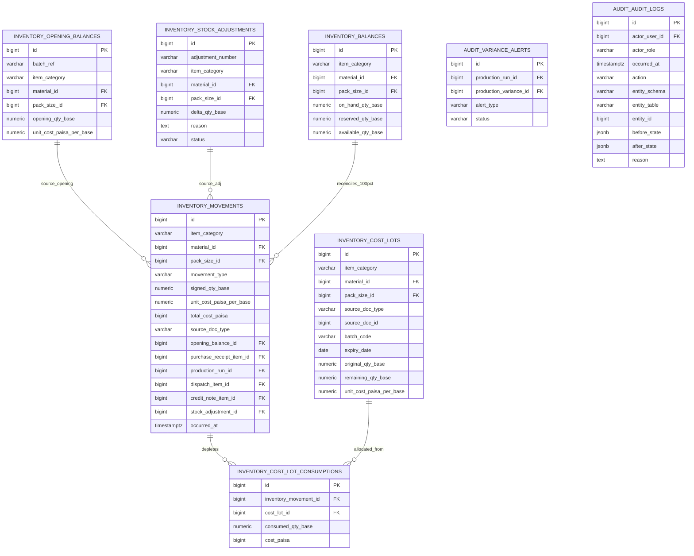

# Physical PostgreSQL Entity-Relationship Diagrams

Matches the exact physical schemas, table names, PostgreSQL data types, primary/foreign keys, and cardinalities defined in [complete-schema.md](file:///d:/mac/ota/docs/phase3/complete-schema.md).

---

## 1. IAM, Sales Masters & Orders (`iam` + `sales` Schemas)

---

## 2. GST Billing, Dispatches & Finance (`billing` + `finance` Schemas)

---

## 3. Purchasing, BOM, Production & Costing (`purchasing` + `production` + `costing` Schemas)

---

## 4. Inventory Ledger, Cost Lots & Audit (`inventory` + `audit` Schemas)

