# Order Lifecycle State Machine (`state_machine.py`)

Implemented declaratively in [state_machine.py](file:///d:/mac/ota/backend/app/modules/orders/state_machine.py) and enforced in [service.py](file:///d:/mac/ota/backend/app/modules/orders/service.py) plus PostgreSQL constraints in [0002_phase5_order_lifecycle.py](file:///d:/mac/ota/backend/alembic/versions/0002_phase5_order_lifecycle.py).

---

## 1. Allowed State Transitions Diagram

```mermaid
stateDiagram-v2
    [*] --> SUBMITTED : Salesman submits order
    SUBMITTED --> UNDER_REVIEW : Factory Admin opens / modifies / holds order
    SUBMITTED --> CORRECTION_REQUESTED : Factory Admin requests salesman correction (reason required)
    SUBMITTED --> APPROVED : Factory Admin approves (stock >= qty; reserves FG stock)
    SUBMITTED --> REJECTED : Factory Admin rejects (reason required)
    SUBMITTED --> CANCELLED : Owning Salesman withdraws OR Factory Admin cancels (reason required)

    UNDER_REVIEW --> CORRECTION_REQUESTED : Factory Admin requests correction (reason required)
    UNDER_REVIEW --> APPROVED : Factory Admin approves (stock >= qty; reserves FG stock)
    UNDER_REVIEW --> REJECTED : Factory Admin rejects (reason required)
    UNDER_REVIEW --> CANCELLED : Factory Admin cancels (reason required)

    CORRECTION_REQUESTED --> SUBMITTED : Owning Salesman edits qty/notes & resubmits
    CORRECTION_REQUESTED --> REJECTED : Factory Admin rejects (reason required)
    CORRECTION_REQUESTED --> CANCELLED : Owning Salesman withdraws OR Factory Admin cancels

    APPROVED --> CANCELLED : Factory Admin cancels pre-invoice (releases StockReservation)
    REJECTED --> [*]
    CANCELLED --> [*]
```

---

## 2. Explicit Transition Guard Matrix

| Current Status | Allowed Target Statuses | Permitted Role(s) | Mandatory Guards & Side Effects |
| --- | --- | --- | --- |
| `SUBMITTED` | `UNDER_REVIEW`, `CORRECTION_REQUESTED`, `APPROVED`, `REJECTED`, `CANCELLED` | `FACTORY_ADMIN` (also owning `SALESMAN` for `CANCELLED`) | `APPROVED` requires full FG `Available >= Effective Qty`; `REJECTED` / `CORRECTION_REQUESTED` / `CANCELLED` require `reason >= 5 chars`. |
| `UNDER_REVIEW` | `CORRECTION_REQUESTED`, `APPROVED`, `REJECTED`, `CANCELLED` | `FACTORY_ADMIN` | Quantity & unit-price edits allowed only in `SUBMITTED` or `UNDER_REVIEW`; moves `SUBMITTED -> UNDER_REVIEW` once when edited. |
| `CORRECTION_REQUESTED` | `SUBMITTED` (Salesman), `REJECTED`, `CANCELLED` | Owning `SALESMAN` (resubmit/cancel), `FACTORY_ADMIN` (reject/cancel) | Salesman resubmit refreshes authoritative prices from active Price List and clears `approved_qty_pkts`. |
| `APPROVED` | `CANCELLED` *(Phase 6+ adds `INVOICED`)* | `FACTORY_ADMIN` only | Locked against qty/price edits and Salesman modification/cancellation; `CANCELLED` atomically releases active `StockReservation` rows. |
| `REJECTED` | *(Terminal — None)* | None | Any transition or edit returns `409 Conflict` (`INVALID_STATE_TRANSITION` / `ORDER_LOCKED`). |
| `CANCELLED` | *(Terminal — None)* | None | Any transition or edit returns `409 Conflict`. |

---

## 3. Concurrency, Repeat & Duplicate-History Prevention

1. **Pessimistic Row Locking:** Every transition and edit acquires `SELECT ... FROM sales.sales_orders WHERE id = :id FOR UPDATE` via `get_order_by_id_for_update()` before evaluating status. Two simultaneous approval calls serialize cleanly; the second reads `status = 'APPROVED'` and fails with `409 INVALID_STATE_TRANSITION`.
2. **Optimistic Revision Check (`version`):** Admin actions optionally accept `expected_version`, rejecting stale browser tabs with `409 VERSION_CONFLICT`.
3. **Database No-Op History Block:** `sales.sales_order_status_history` enforces `CHECK (from_status IS DISTINCT FROM to_status)`, making identical self-transition history rows impossible at the PostgreSQL engine level. When an order is already `UNDER_REVIEW`, logging a fresh stock snapshot updates `sales_order_approvals` without inserting duplicate status history rows.
4. **Edit Lock Reconciled Policy:** Once an order enters `APPROVED` (and stock reservations are committed), quantities and prices are locked (`ORDER_LOCKED`) rather than mutating reserved commitments in-place; if quantities must change post-approval, Admin cancels (`APPROVED -> CANCELLED`, releasing reservations cleanly) with an audit reason.
